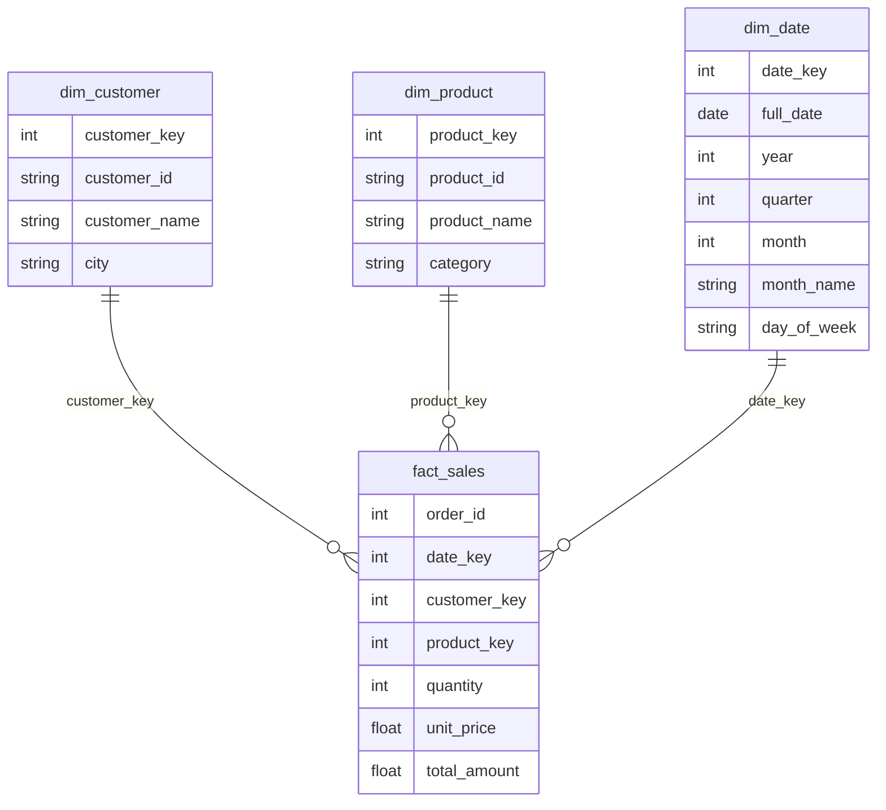

# Retail Sales Data Warehouse: Star Schema ETL

An ETL project that takes a messy raw sales CSV, cleans it, rejects bad records with reasons, and builds a **star schema** data warehouse (fact + dimension tables) in SQL, followed by automated validation checks and example analytical queries.

## Star schema



## Pipeline flow

```
raw_sales.csv -> Extract -> Clean (dedupe, validate) -> Staging table
                                   |                         |
                                   +--> rejected_sales       +--> Build dimensions + fact (surrogate keys)
                                        (with reject_reason)          |
                                                                      +--> Validation checks (SQL)
```

## What it demonstrates

- **Data cleaning:** removes exact duplicates; rejects rows with missing customer, bad dates, or invalid quantity, and stores them with a `reject_reason`
- **Dimensional modeling:** customer, product and date dimensions with surrogate keys, and a sales fact table
- **Data validation in SQL:** row-count reconciliation, orphan foreign key checks, duplicate checks, revenue reconciliation between staging and fact
- **Analytics:** business queries in `sql/analysis.sql` (monthly revenue, category revenue, top customers)
- **Testing:** unit tests for the cleaning rules and star schema building

## Tech stack

Python, pandas, SQLAlchemy, SQL, pytest, SQLite (default) or SQL Server.

## How to run

```bash
pip install -r requirements.txt
python generate_data.py     # creates data/raw_sales.csv (deliberately dirty data)
python etl.py               # runs the full ETL and validation
python -m pytest -q         # runs the tests
```

Then open `sales_dw.db` in DB Browser for SQLite (or your SQL tool) and run the queries in `sql/analysis.sql`.

### Load into SQL Server instead of SQLite

```bash
pip install pyodbc
# Create an empty database SalesDW first, then (PowerShell):
$env:DB_URL = "mssql+pyodbc://@localhost/SalesDW?driver=ODBC+Driver+17+for+SQL+Server&trusted_connection=yes"
python etl.py
```

## Project structure

```
generate_data.py      creates sample raw data
etl.py                extract, clean, build star schema, load, validate
sql/analysis.sql      example analytical queries
tests/test_etl.py     unit tests
```

## Screenshots

Add a screenshot of your validation log output and one query result here.

## What I learned

- Designing a star schema and generating surrogate keys
- Rejecting and tracking bad records instead of silently dropping them
- Validating a warehouse load with SQL reconciliation checks
